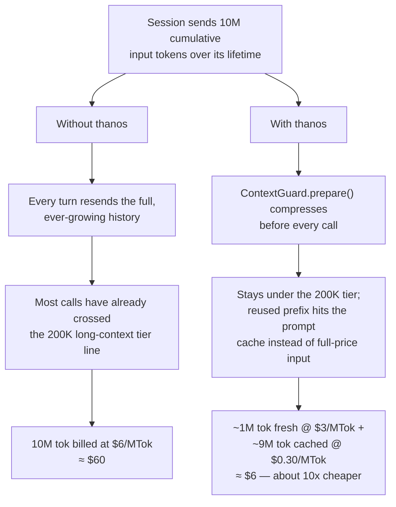

# thanos

[](https://github.com/freakomonk/thanos/actions/workflows/ci.yml)
[](https://pypi.org/project/thanos-ctx/)
[](https://www.npmjs.com/package/thanos-ctx)
[](LICENSE)

LLM API pricing isn't flat. Cross a context-length threshold (e.g. a "long
context" tier above 200K tokens), or write/read from the prompt cache, and
the per-token rate jumps — sometimes by 2x or more. Most apps and agent
loops just let conversation history grow, with no visibility into which
pricing tier a given call falls into or what it's about to cost until the
bill shows up.

**Illustrative example** — a session that transmits 10M cumulative input
tokens over its life, on `claude-sonnet-4-5` ($3/$15 per MTok under 200K
tokens, $6/$22.5 above, $0.30/MTok to read the prompt cache):



Illustrative only — the real split between "fresh" and "cached" tokens
depends on how much of your history is actually reusable, and the exact
rates depend on the model (see [Supported models](#supported-models)
below). The mechanism is what's real: staying under a pricing tier and
reusing the prompt cache instead of re-billing the same history every
turn.

`thanos` is a tiny, dependency-light utility — in Python or
TypeScript/JavaScript, with no SDK or framework lock-in — that wraps the
plain message list you're about to send, tells you which tier you're in
and what it'll cost, and compresses the history automatically before you
cross a limit you set: a context-window ceiling, a pricing tier, a token
budget, or a dollar budget.

```bash
pip install thanos-ctx      # or: npm install thanos-ctx
```

(Published as `thanos-ctx` on PyPI/npm — the bare `thanos` name was already
taken on both by unrelated projects. The CLI command, the Python import,
the GitHub repo, and the Claude plugin/skill all still use the plain
`thanos` name — only the registry package name differs.)

```python
from thanos import ContextGuard

guard = ContextGuard(model="claude-sonnet-4-5")
result = guard.prepare(messages)
# result.messages            -> compressed if needed, otherwise unchanged
# result.tokens, result.estimated_cost_usd, result.compressed
```

It never calls the model, never makes a network request, and never
mutates messages before your cache breakpoint — the default compressor
only drops the oldest *non-pinned* turns.

## Packages

- [`python/`](python/) — `pip install thanos-ctx` — full usage docs, custom compressors, budgets
- [`js/`](js/) — `npm install thanos-ctx` — full usage docs, custom compressors, budgets

Both implement the same small set of concepts:

| Concept | What it does |
|---|---|
| `ModelProfile` / model registry | Context window, pricing tiers, cache write/read rates per model. Ships Anthropic + OpenAI presets; add your own via a plain config object — no code changes. |
| `Tokenizer` | Counts tokens for a message list. Defaults to a fast offline estimate; swap in an exact provider token-count call if you want precision. |
| `Compressor` | Shrinks a message list to fit a token target. Default keeps the pinned prefix and drops the oldest turns; swap in your own (e.g. an LLM-summarization callback). |
| `Budget` | Optional cumulative token/dollar ceiling across a whole conversation, checked alongside the context-window/tier limit. |
| `ContextGuard` | Ties the above together: `prepare(messages)` → tokens, tier, estimated cost, and the (possibly compressed) messages to actually send. |

## Supported models

Source of truth: [`python/thanos/data/models.json`](python/thanos/data/models.json)
— the Python package bundles it directly; the JS package's `npm run build`
copies it in via `js/scripts/sync-pricing.mjs`, so there is exactly one
file to edit. The table below is generated from it by
[`scripts/generate-model-table.mjs`](scripts/generate-model-table.mjs); CI
fails if they drift apart (see the `docs` job in
[`.github/workflows/ci.yml`](.github/workflows/ci.yml)). Run
`node scripts/generate-model-table.mjs` after editing `models.json`.

**Pricing data is illustrative and will go stale** — check it against the
provider's own pricing page. Unprefixed ids (`claude-sonnet-4-5`, `gpt-5`)
are each provider's direct API; `bedrock/*` and `azure/*` are a small
hand-curated set of flagship models on AWS Bedrock and Azure AI Foundry;
`openrouter/*` is mirrored programmatically from
[OpenRouter's public model catalog](https://openrouter.ai/api/v1/models),
so it reflects OpenRouter's own pricing, not the underlying provider's.
Anything not listed raises an error unless you add it yourself via the
`models` option on `ContextGuard`, with no need to touch this file or
this repo.

<!-- MODELS_TABLE:START -->
| Model id | Provider | Context window | Tiers (maxTokens: input/output $ per MTok) | Cache write/read $ per MTok |
|---|---|---|---|---|
| `claude-sonnet-4-5` | anthropic | 1,000,000 | ≤200,000: $3/$15; ≤1,000,000: $6/$22.5 | 3.75 / 0.3 |
| `claude-opus-4-5` | anthropic | 200,000 | ≤200,000: $5/$25 | 6.25 / 0.5 |
| `claude-haiku-4-5` | anthropic | 200,000 | ≤200,000: $1/$5 | 1.25 / 0.1 |
| `gpt-5` | openai | 400,000 | ≤400,000: $1.25/$10 | 0 / 0.125 |
| `gpt-5-mini` | openai | 400,000 | ≤400,000: $0.25/$2 | 0 / 0.025 |
| `bedrock/claude-sonnet-4-5` | bedrock | 1,000,000 | ≤200,000: $3/$15; ≤1,000,000: $6/$22.5 | 3.75 / 0.3 |
| `bedrock/claude-opus-4-5` | bedrock | 200,000 | ≤200,000: $5/$25 | 6.25 / 0.5 |
| `bedrock/claude-haiku-4-5` | bedrock | 200,000 | ≤200,000: $1/$5 | 1.25 / 0.1 |
| `bedrock/nova-pro` | bedrock | 300,000 | ≤300,000: $0.8/$3.2 | - |
| `bedrock/nova-lite` | bedrock | 300,000 | ≤300,000: $0.06/$0.24 | - |
| `bedrock/nova-micro` | bedrock | 128,000 | ≤128,000: $0.035/$0.14 | - |
| `bedrock/llama-3.3-70b` | bedrock | 128,000 | ≤128,000: $0.72/$0.72 | - |
| `bedrock/mistral-large` | bedrock | 131,000 | ≤131,000: $2/$6 | - |
| `azure/gpt-5` | azure | 400,000 | ≤400,000: $1.25/$10 | 0 / 0.125 |
| `azure/gpt-4o` | azure | 128,000 | ≤128,000: $2.5/$10 | 0 / 1.25 |

Showing 15 of **472 models** — see [`python/thanos/data/models.json`](python/thanos/data/models.json) for the full list (including all OpenRouter-mirrored entries as `openrouter/<slug>`), or run `thanos models` / `npx thanos-ctx models`.

<!-- MODELS_TABLE:END -->

## CLI

Both packages install a `thanos` command for checking a conversation from
a shell or a CI step, without writing any code:

```bash
# Python, after `pip install thanos-ctx`
thanos check conversation.json --model claude-sonnet-4-5

# JS/TS, no install needed
npx thanos-ctx check conversation.json --model claude-sonnet-4-5
```

```
model:           claude-sonnet-4-5
messages:        42 -> 42
tokens:          18234 (tier ceiling 200000)
estimated cost:  $0.054702
limit exceeded:  false
```

`conversation.json` is a JSON array of `{role, content}` messages (or an
object with a `"messages"` key); pass `-` to read from stdin instead of a
file. Add `--max-tokens`/`--max-cost-usd` to check against a budget, and
`--json` for a machine-readable report. The command exits `1` when the
limit is exceeded, so it doubles as a CI gate:

```bash
npx thanos-ctx check conversation.json --model claude-sonnet-4-5 --max-cost-usd 0.50 || echo "over budget"
```

`thanos models` (optionally with `--json`) lists the registry from either
package the same way.

## Claude Skill

This repo also ships [`thanos-context`](skills/thanos-context/SKILL.md),
an [Agent Skill](https://github.com/freakomonk/thanos) that teaches
Claude (or any Agent-Skills-compatible harness) when and how to reach for
`thanos` in someone else's codebase — no framework assumptions, same as
the library itself.

**Claude Code**, one-time setup, then it's available everywhere:

```
/plugin marketplace add freakomonk/thanos
/plugin install thanos@thanos
```

**Any other Agent-Skills-compatible host**: skills are just files — copy
or symlink [`skills/thanos-context/`](skills/thanos-context/) into
wherever that host loads skills from (e.g. `~/.claude/skills/` or a
project's `.claude/skills/` for Claude Code itself, if you'd rather skip
the plugin).

## Design choices

- **No framework or SDK coupling.** `prepare()` takes and returns a plain
  list of `{role, content}` messages, so it drops into a raw SDK call, a
  LangChain chain, a hand-rolled agent loop — anything.
- **Cache-aware by default.** A `pinnedPrefixLen` marks how many leading
  messages sit before your provider's cache breakpoint; the default
  compressor never touches them, since reordering or dropping a message
  inside that prefix busts the cache and forces a full (expensive)
  cache-write on the next call.
- **Never throws by default.** Hitting a limit auto-compresses and fires an
  `onLimit`/`on_limit` callback you can log or alert on. Pass
  `raiseOnLimit`/`raise_on_limit=True` if you want a hard stop instead.
- **Everything pluggable, sane defaults free.** The tokenizer, compressor,
  and pricing table all have a zero-dependency default, but are each a
  single-method interface you can replace.

## Development

```bash
# Python
pip install -e "./python[dev]"
ruff check python/thanos python/tests && ruff format --check python/thanos python/tests
pytest python/tests -q

# JS/TS
cd js && npm install
npm run lint   # tsc --noEmit + prettier --check
npm test
npm run build
```

CI (`.github/workflows/ci.yml`) runs the same commands, plus a `docs` job
that regenerates the model table above and fails if `README.md` drifted.

## License

MIT — see [LICENSE](LICENSE).
